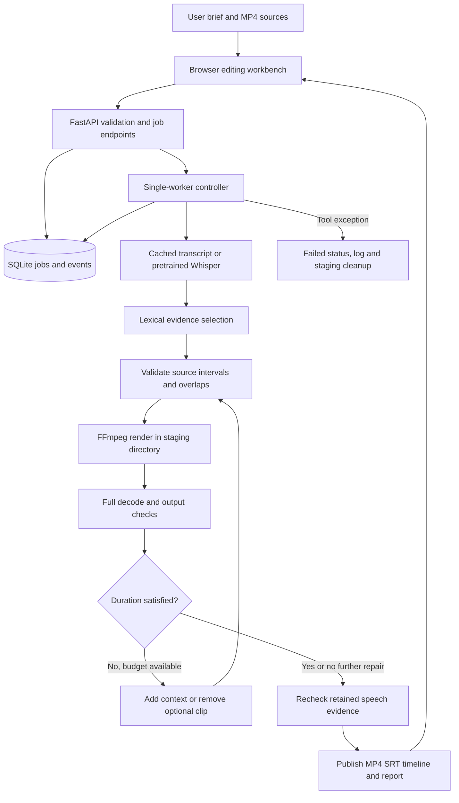

# Implemented architecture

Group 59: Gao Xuefei, Wang Ling, Zhang Yiqun, Fu Xuanyu.

The loop allows three renders and at most two repairs. Manual timeline submission skips automatic duration repair. `complete` means the implemented checks passed, not independent semantic approval. Missing requirements yield `needs_review`. Exceptions yield `failed`. Revisions reuse the existing job transcript; no cross-session preference memory exists.

## Component and contract map

| Layer | Input | Output/state | Implementation |
| --- | --- | --- | --- |
| Interface | Files, topics, duration, aspect, manual cuts | API requests and source/output previews | web/index.html, app.js, styles.css |
| Boundary | Multipart MP4 upload or typed JSON | Validated job and queue transition | app.py |
| Persistence | Job fields and events | SQLite JSON fields, latest version counter | storage.py |
| Perception | English audio | Cues with source ID, start/end and word times | media.transcribe |
| Planning | Cues and supported brief constraints | Source-linked clips with reasons/evidence IDs | planning.build_timeline |
| Execution | Valid timeline, subtitles, aspect | H.264/AAC MP4 and SRT | media.render |
| Feedback | Encoded media and retained cues | Technical checks, repairs, unresolved requirements | media.verify, service._process |

## State and timing

`queued -> running -> complete / needs_review / failed`. Within running: transcribing, planning, rendering, verifying, optionally repairing. Revision uses replanning and cached transcript. Source word time t maps to the output by adding preceding clip durations and subtracting the selected clip's source start. Bounds and overlaps are validated before rendering; subtitles are rebuilt from retained words after edits.

## Tradeoffs

CPU Whisper removes the GPU requirement but limits throughput. A single executor simplifies local execution but queues jobs without a capacity limit. SQLite persists state, but does not resume interrupted jobs. Staging protects prior exports; publication replaces individual files rather than a transactional version directory. Revision locking applies to one server process. Lexical matching is inspectable but cannot resolve negation, paraphrases or visual-only requests. No LangGraph, MCP, embeddings, generative LLM planner or visual model is implemented.
