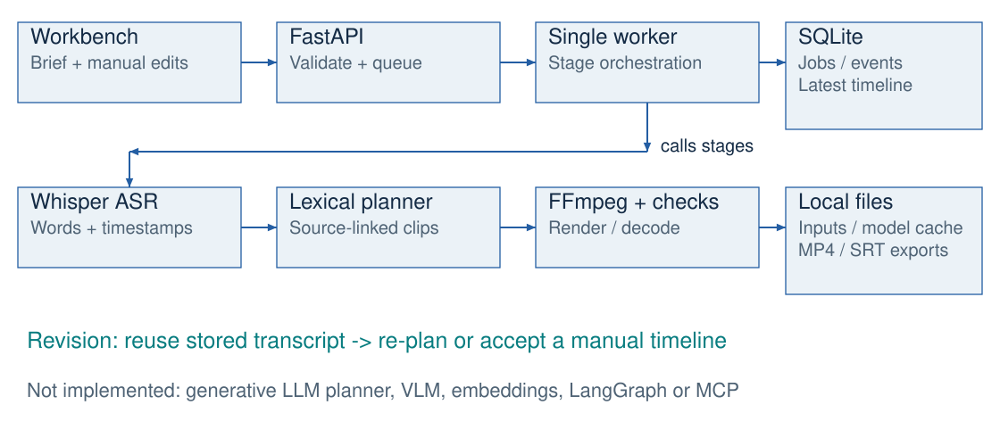
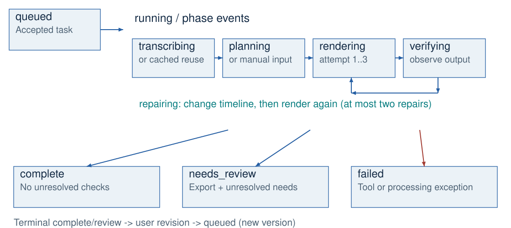
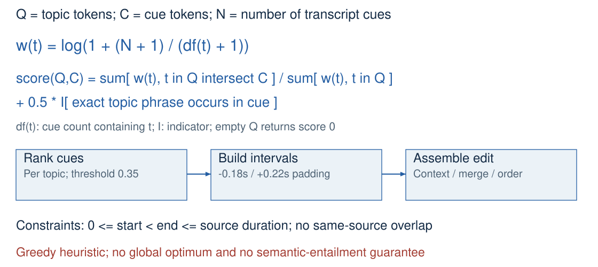
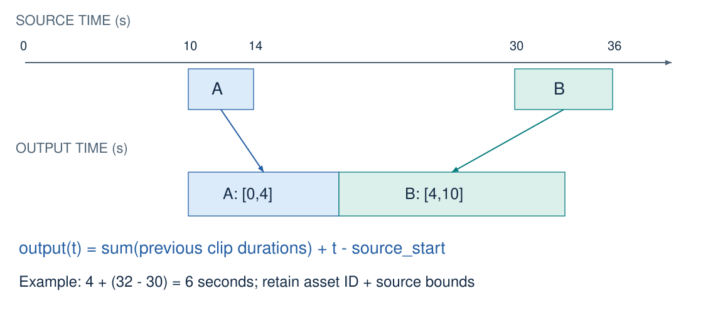
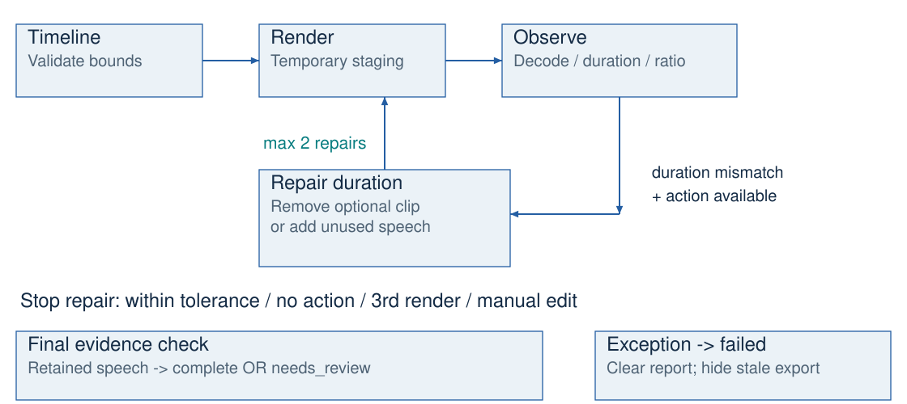
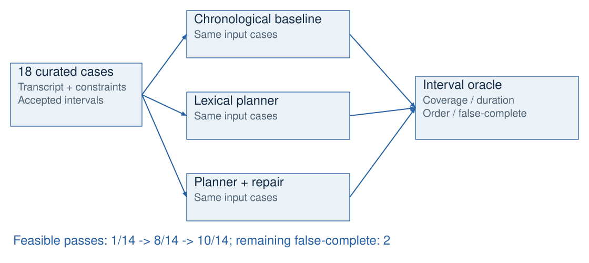

# ClipAgent: Evidence-Grounded Video Editing

COMP7608B · Group 59 · Final-report draft · 18 November 2026

Members: Gao Xuefei, Wang Ling, Zhang Yiqun, Fu Xuanyu. Individual contributions remain pending final team confirmation; proposed responsibilities are not evidence of actual authorship.

## 1. Abstract and problem

ClipAgent turns a short editing brief and one to three English MP4 sources into a recap, subtitles, an editable timeline, and a verification report. The intended users are students and presenters who need to locate relevant spoken passages without repeatedly scrubbing a recording. Every selected clip retains its source identifier and timestamps so the user can inspect and correct the selection.

The delivered application combines local pretrained Whisper speech recognition, deterministic lexical selection, FFmpeg rendering, and a bounded observation-and-repair controller. It autonomously selects clips, invokes media tools, observes the exported file, and makes up to two duration repairs before stopping. It is not an LLM planner or a multimodal reasoning system. No training or fine-tuning was performed.

The retained synthetic component benchmark contains 18 cases and three methods. On 14 feasible cases, chronological selection passes 1, planning without repair passes 8, and planning with repair passes 10. These are developer-authored transcript fixtures, not the proposed real-world dataset or a human quality study. Evaluation identified a repair-order regression, which was fixed and retested. Semantic false positives remain. This report distinguishes component measurements from real media checks and injected failure tests.

## 2. Objectives, requirements and proposal changes

The intended interaction is upload, brief, autonomous draft, inspect evidence, optionally revise, and download. The brief can specify topics, duration, aspect ratio, and a first topic. The application supports MP4/SRT exports and downloadable timeline/report JSON. It accepts at most three sources, 15 minutes of combined footage, and 2 GiB of upload bytes. These are enforced limits, not a demonstrated maximum-workload performance guarantee.

| Proposal or guideline expectation | Delivered scope and evidence |
| --- | --- |
| Full autonomous agent with decisions, tools, observations and stopping | A deterministic closed-loop controller performs selection, render, verification and bounded duration repair. Whether this narrower agent meets the course interpretation remains a review question. |
| Language-model orchestration, LangGraph or MCP | Not implemented. Python functions and FastAPI coordinate execution; no generative LLM is called at runtime. |
| Grounded retrieval and visual reasoning | Timestamped speech retrieval is implemented. Preview thumbnails support human inspection; embeddings and visual semantic interpretation are absent. |
| Persistent memory and recovery | SQLite stores jobs, transcripts, latest timelines and events. Revisions reuse transcripts. Cross-session preference memory and interrupted-job resume are absent. |
| Original 32 recordings / 64 briefs | Not delivered. The current synthetic benchmark is smaller and materially different in provenance and scope. |
| Failure handling and evaluation | Source, render, decode, duration and evidence checks exist; retained tests distinguish real and injected cases. Known failures remain visible. |
| Reproducibility and team/AI disclosure | README names the four members and gives setup commands; source, evaluation evidence and partial AI prompt disclosure are included. Individual attribution awaits team confirmation. |

The shift from the proposed LLM/multimodal architecture and real recording dataset to a local deterministic speech-based prototype may constitute a major proposal scope change. The team should disclose this through the course change process and seek the required course decision. This report does not claim the change was approved, nor classify all guideline requirements as fulfilled. The provided two-page guideline summary informs this coverage; it is not a substitute for the course's final assessment.

The engineering rationale visible in the implementation is a small CPU-based application with inspectable decisions and no runtime cloud API dependency. That rationale explains the current design but does not retrospectively establish course approval or individual decision authorship. The earlier `docs/PLAN.md` is a roadmap containing unimplemented future work, not an implementation inventory.

## 3. System architecture and implementation

The browser workbench calls a local FastAPI server. The server validates uploads, probes source streams, writes job state, and schedules a single background worker. The worker obtains a timestamped transcript, constructs a timeline, renders an export, verifies it, and either repairs or publishes a reviewable result. SQLite contains structured state and events; media and cached model files remain on local disk. The editable architecture diagram is in `docs/ARCHITECTURE.md`; the presentation can visualize the same structure.

| Component | Actual responsibility and source |
| --- | --- |
| Browser workbench | `web/`: source/output preview, thumbnails, editable timeline, evidence, verification and activity display. |
| API and input boundary | `app.py`: upload/probe, revision readiness, timeline validation, job polling and artifact downloads. |
| State | `clipagent/storage.py`: SQLite jobs and append-only events; latest timeline and version counter, not complete immutable timeline history. |
| Controller | `clipagent/service.py::_process`: transcription or cached reuse, planning, render/verify loop, repair limit, publication and terminal state. |
| Selection and evidence | `clipagent/planning.py`: request parsing, lexical ranking, clip assembly, timeline validity, retained-speech checks and subtitle timing. |
| Media tools | `clipagent/media.py`: PyAV probe, local faster-whisper ASR, FFmpeg frame/render/full-decode checks. |

Whisper defaults to `tiny.en`, CPU execution and INT8 computation. The loader requires already-cached model files (`local_files_only=True`). The README separates initial installation/model acquisition from subsequent local processing. ASR produces word timestamps and groups words into cues at sentence boundaries or roughly 12 seconds. This is pretrained inference; the project does not build a new speech model.

The renderer normalizes each clip to 30 fps and either 720×1280 or 1280×720 with aspect-preserving scaling and padding. H.264 video and AAC audio are concatenated, and nonempty subtitles are burned into the MP4 while also being saved as SRT. Silent sources receive a silent audio stream. Consequently, an audio-stream presence check does not prove audible speech or satisfactory sound quality.

## 4. Agent decisions, observations and stopping

The agent's goal is a source-grounded recap satisfying the supported brief constraints. Its state consists of the brief/options, source metadata, transcript, timeline, version, render observations, repairs, unresolved requirements and phase events. Its actions are Python tool calls, not externally exposed MCP tools. The default run does not need a human to choose individual cuts, but optional manual edits and revisions remain available.

Request parsing uses explicit patterns for duration, orientation, topic lists and first-topic instructions. Topic ranking computes weighted token overlap with an exact-phrase bonus. Each topic selects its highest-ranked cue above a threshold of 0.35. The planner pads the cue by 0.18 seconds before and 0.22 seconds after, adds chronological supporting context toward minimum duration, merges nearby clips from the same source, and optionally moves a matching clip first. These are meaningful data-dependent decisions, although their vocabulary and semantics are limited.

| Decision point | Observation and action | Code link |
| --- | --- | --- |
| Source acceptance | Stream probe and resource limits accept or reject uploads before processing. | `app.py::create`, `_queue`; `media.py::probe` |
| Evidence selection | Transcript token matches choose required clips; insufficient evidence becomes unresolved. | `planning.py::_score`, `build_timeline` |
| Render validation | Decode, dimensions, audio presence and measured duration inform the next action. | `media.py::verify`; `service.py::_process` |
| Duration repair | Remove an optional clip if too long; add unused nonoverlapping speech if too short. | `planning.py::repair_duration` |
| Semantic diagnostic | Recompute topic matches from speech retained inside final clip bounds. | `planning.py::review_timeline_evidence` |
| Stop/publication | At most three renders; no repair when unavailable or after manual edits; publish complete/review or fail on exceptions. | `service.py::_process` |

A concrete retained decision trace is `evaluation/results/traces/challenging_repair_remove__planner_repair.json`. The synthetic brief requires the solution in 8–10 seconds. The first plan contains introduction and solution cues, each padded to 4.4 seconds. A deliberately simulated +3-second duration observation makes the first result 11.8 seconds. Repair removes the optional introduction and retains solution evidence at source 15.82–20.22 seconds. The next simulated observation is 7.4 seconds, accepted by the evaluator's ±0.7-second tolerance. The 7.4-second value is not a measured video duration, and its acceptance below the nominal eight-second minimum illustrates the effect of tolerance.

The controller stops with `complete` when its implemented checks leave no unresolved items, `needs_review` when an export exists but requirements remain unresolved, or `failed` on a tool/processing exception. These labels describe program behavior; `complete` is not proof of semantic correctness. Final checks omit a full semantic and first-topic ordering oracle, which explains several independently scored false-complete cases.

## 5. Failure handling and reliability

| Scenario | Handling and retained evidence | Remaining limit |
| --- | --- | --- |
| Corrupt or unsupported upload | API rejects unreadable/non-MP4 sources; failed upload directories are removed. `tests/test_service.py` exercises invalid media and invalid edits. | Container validation is not a security audit of media decoders. |
| Missing speech or requested topic | Fallback previews are explicitly unverified; missing retained speech stays unresolved and leads to review. | Lexical hits can still misrepresent meaning or negation. |
| Render exception or rejected decode | Worker records failure, clears the report and cleans staging. Artifact readiness blocks stale output access. Injected tests exercise these branches. | Injection proves handling, not the natural frequency of failures. |
| Impossible duration or nonconverging repair | At most three render attempts and two repairs; unresolved duration produces review. | No general semantic, audio-quality or framing repair exists. |
| Concurrent revision or queue submission failure | In-process revision serialization prevents overlapping readiness transitions; scheduling failure marks the job failed. | The lock is not a distributed multi-process coordination mechanism. |

Rendering occurs in a temporary job directory. Successful outputs are moved to the published directory only after checks; failures clean the staging directory. Each file replacement is separate, so this is not a transactional publication of both files. Terminal-state gating protects video/SRT retrieval from a failed or still-running revision. Job polling and event history make failure visible instead of silently presenting an old export as a new success.

Persistence is limited to stored job records and events. The in-process executor is lost if the server exits, and no restart recovery scans queued/running jobs. SQLite persistence must therefore not be described as resumable execution. The single worker reduces simultaneous CPU pressure but does not bound queued work or provide cancellation, fair scheduling, or multi-user isolation.

## 6. Evaluation design and actual results

### 6.1 Dataset and baselines

The retained component run was generated on 17 November 2026 using Python 3.12.10 on macOS ARM64. `evaluation/results/results.json` records exact execution time, Git base and source SHA-256 values. The source hashes identify the evaluated implementation even when Git HEAD predates additions. There are 18 cases: ordinary, challenging, changed-request and explicitly infeasible scenarios. Four are infeasible; 14 are feasible. Labels are developer-authored by the coding agent, without independent human verification or a held-out sample.

The chronological baseline takes early speech without topic ranking. The second method runs the lexical planner without repair. The third adds the bounded duration-repair rule. All methods share request parsing and the same fixtures. The independent scoring function checks explicit acceptable source intervals, duration, ordering, aspect setting and timeline validity. It does not use the planner's reasons or keyword coverage as its scoring oracle, although fixture and oracle authorship are not independent of development.

Each case/method has one warm-up and 20 measured repetitions; deterministic outputs are checked across repetitions. The evaluator simulates rendered duration and does not execute ASR, rendering, the API or persistence. Aspect success here checks an option, not encoded pixels. Component latency excludes independent scoring, file loading, ASR and rendering. Repeated timings do not create new independent evaluation examples.

| Method | Feasible cases passed | Requirement coverage | Expected failures flagged | False complete | Median of case medians |
| --- | --- | --- | --- | --- | --- |
| Chronological | 1/14 | 31.8% | 4/4 | 2 | 0.0292 ms |
| Planner, no repair | 8/14 | 77.3% | 4/4 | 2 | 0.0417 ms |
| Planner + repair | 10/14 | 77.3% | 4/4 | 2 | 0.0413 ms |

Requirement coverage aggregates requirement hits across all 18 cases, including infeasible cases; it is not the feasible-case pass rate. Per-case nearest-rank p95 timings and raw repetitions are retained in the JSON traces. The table's final column is not whole-application latency or a global p95. The small absolute planning overhead is unsurprising for tiny in-memory transcripts and says little about long-recording performance.

### 6.2 Actual limitations exposed

The negation case selects “No solution is presented here” instead of the later actual solution. Lexical evidence checking still reports a match, while the interval oracle rejects it. The synonym case demonstrates that relevant meaning without the same words can be missed. The merged-order case shows that moving a merged clip does not guarantee that the desired topic is heard first within that clip. A separate repair-order regression was corrected by restoring the explicit first-topic selection after adding context. The retained regression test confirms duration and ordering together. The final repair method adds two feasible successes over the no-repair planner; two false-complete cases remain.

These results support a narrow claim: lexical selection improves this curated component benchmark over chronological selection, and bounded repair helps constructed duration cases. They do not establish general semantic understanding, editing quality, or superiority over human editing or an LLM baseline. Four expected failures being flagged does not cancel the remaining false-positive completions.

### 6.3 Media and integration evidence status

The retained system run records nine integration tests, eight passed and one skipped, with no failures or errors. The skipped test requires macOS speech synthesis, which returned empty audio in this environment. A separate test uses the downloaded public WAV and cached Whisper model and passes real ASR/media processing. The suite took 5.445 seconds; this is aggregate test-run time, not per-job latency. The result is recorded in `evaluation/system_results/summary.json`.

The integration traces distinguish real in-process ASGI/SQLite/worker/render/decode operations from injected failures. The decode-rejection case injects `decodable=False` after real rendering; the nonconverging-duration case forces a 99-second observation to exercise the three-render stop. These are not naturally observed corrupt exports.

A separate public-data run processes LibriSpeech test-clean utterance 6930-75918-0003 (CC BY 4.0, redistributed as an NVIDIA test fixture). The 23.315-second audio is wrapped in a visibly labelled synthetic title-card video. The actual local CPU pipeline takes 1.901 seconds in this run and exports a 22.966-second, 1280x720 video with 11 subtitle cues. Decode, audio presence, aspect, duration and subtitle bounds pass. This single service-level smoke test bypasses HTTP/UI and uses a brief with no topic constraints. It proves execution on this fixture, not real-video semantic accuracy. A complete independent reference transcript was not retrieved, so WER is unavailable. Source, attribution, license and checksum are in `sample_data/provenance.json`; actual results and outputs are in `evaluation/public_results/`.

## 7. Non-functional requirements and measurement protocol

| Dimension | Present evidence | Reproducible measurement and acceptance rule |
| --- | --- | --- |
| Latency | Component repetitions above; no representative end-to-end p95. | Record hardware, model/cache state, source minutes and output size. Measure upload-to-terminal time, ASR, render/verify and queue delay separately for cold and warm runs. Use at least 20 runs per workload and nearest-rank p95; agree the user-facing target before acceptance. |
| Cost | No runtime paid LLM/API calls in the inspected path. | Count external calls/tokens, measure process CPU/RSS, wall time and disk growth per job. Report electricity/hardware assumptions separately; zero API charge is not zero operating cost. |
| Workload | Limits: 3 MP4s, 900 source seconds, 2 GiB; one worker. | Test boundary and just-over-limit inputs, 1/2/4 queued jobs, and varied resolution. Record rejection, peak RSS/disk, queue delay, throughput and failures. Full-limit stress results are not yet measured. |
| Privacy | Local media, model inference, SQLite and events; cached-model-only runtime loader. | After setup, deny outbound network and run upload/revision/export while observing connections. Inspect logs and artifacts for raw media, transcripts and paths. No packet-level privacy audit is claimed. |
| Reliability | Explicit stop cap, validation and failure/review states. | Replay invalid media, missing topics, decode/render/queue failures and concurrent revision; retain status, events, output availability and cleanup evidence. Separate injected conditions from naturally occurring failures. |
| Usability | Workbench supports previews, edits, evidence and activity. | Time brief-to-acceptable-export and count manual edits against a manual-editing baseline; collect rubric scores from independent users. No such user study has been completed. |

This is a local single-user demo. It has no authentication, per-user authorization, encrypted application storage, automatic retention expiry or job deletion workflow. Bind it to loopback as documented. Uploads and transcripts remain in `data/` until deliberately removed. Network-free runtime design does not establish that dependencies, setup downloads or the host environment have no privacy risks. General security certification and production deployment are outside the measured scope.

## 8. Reproducibility and standalone application

The README provides the exact setup sequence: create a Python environment, install pinned application dependencies, explicitly cache the Whisper model, prepare sample media, then start Uvicorn on `127.0.0.1:8765`. FFmpeg is supplied by `imageio-ffmpeg`; no separate database server or cloud API key is needed. Initial dependency/model acquisition requires network access. The generated demo uses macOS speech synthesis; direct MP4 upload is the portable path. Portability beyond the measured Python 3.12/macOS environment has not been independently verified.

Reproduce component evaluation with `.venv/bin/python -m evaluation.run --repeats 20 --output evaluation/results`. Run unit/regression tests with `.venv/bin/python -m unittest discover -s tests -v` and retained system checks with `.venv/bin/python scripts/run_system_checks.py`. Inspect provenance and commands in the public sample directory when its evidence is finalized. Running these commands can replace retained result files; compare metadata and source hashes before treating a later result as equivalent.

For a demonstration, upload a source, enter topics and duration, inspect the source-linked selection, download MP4/SRT/JSON, revise the brief, and show the cached-transcript event. Then demonstrate a missing-topic review and a documented injected failure trace. This demonstrates successful execution and limits without presenting an injected scenario as ordinary user data. Report PDF rendering is handled by `scripts/build_report.py`; Markdown remains the editable source.

## 9. Work history and team contributions

The repository history records initialization on 9 October 2026, the local editing demo and provenance/subtitle improvements that day, retained-evidence review after manual edits on 11 October, responsive UI work on 14 October, and interactive/professional workbench updates on 13 November. The exact seven commits and timestamps are listed in `docs/WORK_LOG.md`. All seven use Git author “Kenufu”; that identity alone cannot establish which group member did each task.

Proposed responsibilities were Gao Xuefei for media, Wang Ling for controller/API, Zhang Yiqun for retrieval, and Fu Xuanyu for UI/evaluation. Actual individual attribution is pending final team confirmation after work is completed, as requested by the user. The repository demonstrates completed system components, not a verified division of human effort. Submission additions and bug fixes are documented in WORK_LOG; the ZIP's SHA256 manifest identifies the delivered source snapshot.

## 10. AI use, limitations and next steps

Codex assisted with development and this report/documentation task. The current runtime identifies itself as GPT-6; exact historical model identifiers are unknown. `docs/AI_USE_DECLARATION.md` and `docs/prompts/project-prompts.md` disclose the known assistance and a partial retained prompt record. Reconstructed task summaries are labelled paraphrases, not fabricated verbatim transcripts. Runtime Whisper inference is separate from AI coding assistance, and no generative LLM planner is delivered.

The next technical priorities are independent human annotation, a representative licensed/consented recording set, semantic evidence checks that handle negation and synonyms, and an order invariant rechecked after each merge or repair. Representative end-to-end latency, resource and usability measurements should precede claims about practical editing workload. Restart recovery and stronger privacy/access controls would be necessary for broader deployment. Training remains unjustified without a benchmark isolating a failure that simpler changes cannot resolve.

The delivered result is an inspectable local prototype with real media tools, bounded automatic repair and explicit review states. Its reported measurements establish a reproducible component baseline and expose meaningful failures. They do not establish completion of the original multimodal proposal, approval of scope changes, or independently verified individual contributions.

## 11. Evidence references

| Reference | Purpose |
| --- | --- |
| `README.md`, `requirements.txt` | Setup, limits, dependency versions and member names. |
| `docs/ARCHITECTURE.md`, `docs/REQUIREMENTS_MATRIX.md` | Editable Mermaid architecture, code mapping and guideline gaps. |
| `evaluation/cases.json`, `evaluation/run.py` | Synthetic fixtures, baseline definitions and independent interval oracle. |
| `evaluation/results/results.json`, `results.csv`, `traces/` | Recorded aggregate/per-case outcomes, timings, provenance and source hashes. |
| `evaluation/system_results/summary.json`, `traces.json` | Integration outcome and labelled real/injected control-flow evidence. |
| `docs/WORK_LOG.md`, `docs/CONTRIBUTIONS.md` | Verified Git history, working-tree work and attribution status. |
| `docs/AI_USE_DECLARATION.md`, `docs/prompts/project-prompts.md` | AI tools, limits of retained history and partial prompt disclosure. |
